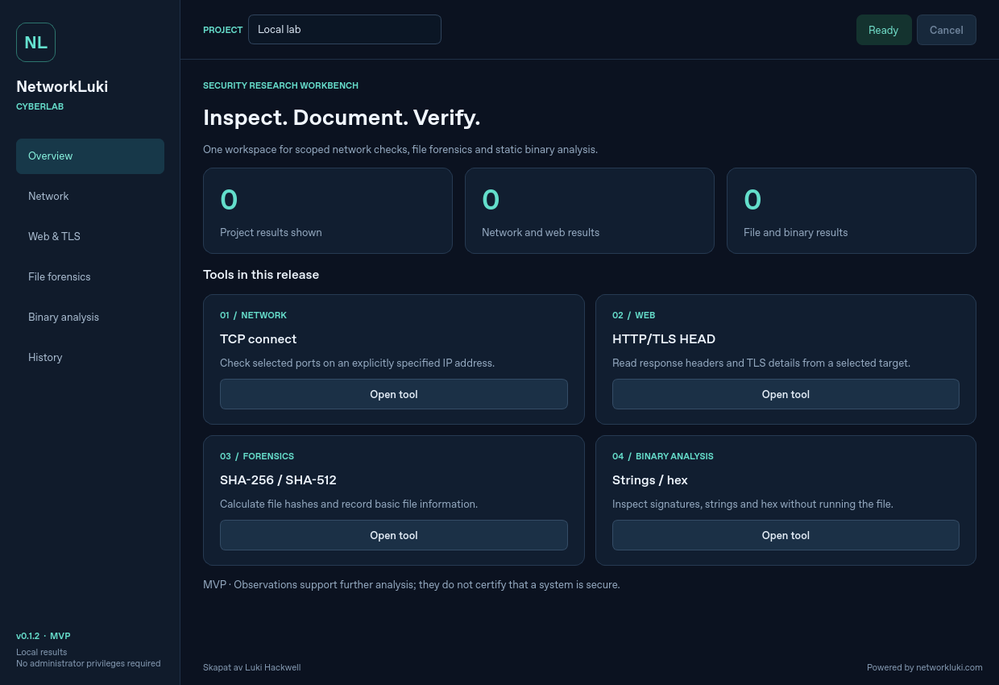

# NetworkLuki CyberLab

**Version 0.2.0 — workspace preview**



An open-source desktop workspace with an English interface for **daily tasks, server observations, development review, bounded Python code review, and local JSON/text utilities**, with an optional AI assistant. Scoped network checks, web/TLS inspection, file hashing, static binary inspection, and project-based JSON history remain available.

The intended desktop targets are **Windows, Linux, and macOS**, using Python and Qt for Python. This is a bounded workspace preview, not a complete penetration-testing suite or a claim of being the “most advanced” security tool. The `codex/workspace-0.2.0` branch is configured to build Windows x64 and Debian 13 amd64 installers as CI artifacts; it does not automatically publish a release. macOS remains a source-only target without platform verification. See the [verification notes](docs/VERIFICATION.md) for checks actually performed.

## Native installers

The existing published release is **0.1.2**, available from [GitHub Releases](https://github.com/networkluki/networkluki-cyberlab/releases). It contains the earlier security workbench, without the new workspace pages. For 0.2.0 preview installers, use the artifacts from a successful workspace-branch [Actions run](https://github.com/networkluki/networkluki-cyberlab/actions) and inspect its verification reports; a configured build is not proof that an artifact has passed.

Native packages include Python and Qt. The Windows installer is unsigned and installs for the current user. The Debian package requires administrator privileges to install, then runs as a normal desktop application. For the published 0.1.2 package:

```bash
sudo apt install ./networkluki-cyberlab_0.1.2_amd64.deb
networkluki-cyberlab
```

The footer displays `Skapat av Luki Hackwell` on the left and `Powered by networkluki.com` on the right. The rest of the application interface is English.

## Implemented modules

| Workspace page | Available in the 0.2.0 preview | Boundaries |
| --- | --- | --- |
| Daily tasks | Project checklist, optional due dates, open/done status, links to evidence records | At most 1,000 tasks per project; the table shows the latest 200; no scheduled execution or notifications |
| Servers | On-demand local snapshot, imported server JSON, keyword-based log review | Point-in-time observations only; no SSH, agents, continuous polling, or system changes |
| Development | Project file inventory and selected Python source review | Metadata inventory capped at 2,000 entries; Python AST triage capped at 512 KiB; no project code, tests, or build commands run |
| Code review | Five bounded Python AST checks with source hash, locations and remediation guidance | UTF-8 `.py`/`.pyw` files up to 256 KiB; findings require review and are not confirmed vulnerabilities; source is never executed |
| Utilities | Strict JSON validation/formatting and bounded text comparison | 128 KiB per input; duplicate JSON keys rejected; diff input capped at 1,000 lines and output at 256 KiB; no source files are modified |
| AI assistant | Explanation of evidence explicitly reviewed and sent to an optional Ollama service | Loopback endpoint only, downloaded local model required, cloud features must be disabled; output is unverified and never executes actions |

[Workspace guide](docs/WORKSPACE.md) covers daily work, server collection, development review and AI setup. [Combined workbench guide](docs/WORKBENCH.md) documents the dedicated code-review and JSON/text utility pages and their exact limits. AI integration has been checked with fixtures; inference with a real model has not been tested.

| Security module | Available behavior | Boundaries |
| --- | --- | --- |
| Network | TCP connection checks against one explicit IPv4 or IPv6 address | Up to 128 selected ports, at most 8 workers, 0.6-second connection timeout per port; no host discovery or service identification |
| Web / TLS | One HTTP `HEAD` request, response headers, contextual security-header observations, verified HTTPS metadata | No redirects, body analysis, proxy inheritance, authentication, or `GET` fallback; first validated DNS address is pinned for the connection |
| File analysis | SHA-256 and SHA-512, size, modification time, file-type signature hints | Regular files up to 2 GiB; detectable changes during inspection discard the result |
| Static binary inspection | Signature hints, initial hex preview, printable ASCII strings and offsets | First 4 MiB examined, at most 200 strings of at least 6 characters, 240-character string previews, first 512 bytes as hex; no execution or disassembly |
| Results | Local SQLite history, project labels, JSON export | History displays the latest 200 entries, with a combined 16 MiB payload limit; local observations, not signed reports or a forensic chain of custody |

An open port is not proof of a vulnerability. A header's presence or absence does not establish whether an application's configuration is secure. File signatures identify possible formats; they do not validate a file or establish that it is safe.

## Run from source

Use **Python 3.11 or newer** with a compatible `PySide6-Essentials` wheel. The application currently pins `PySide6-Essentials==6.12.0`. Platform availability also depends on that dependency's supported OS and CPU architecture. A desktop graphical session is required.

Extract the project, then open a terminal in the directory containing `pyproject.toml`. Installation downloads the declared build and runtime dependencies. Use a virtual environment; administrative privileges and system policy changes are unnecessary.

### Windows PowerShell

The following example uses an installed Python 3.12 interpreter and the Python launcher:

```powershell
py -3.12 -m venv .venv
.\.venv\Scripts\python.exe -m pip install .
.\.venv\Scripts\python.exe -m networkluki_cyberlab
```

### Linux and macOS

```bash
python3 -m venv .venv
.venv/bin/python -m pip install .
.venv/bin/python -m networkluki_cyberlab
```

The Python interpreter must provide `venv` and `pip`. On Linux, Qt also needs the desktop libraries required by the installed distribution and Qt platform plugin; this source bundle does not install system packages.

## Use

1. Set the project label to keep tasks and evidence together.
2. Use **Daily tasks**, **Servers**, **Development**, **Code review**, or **Utilities**, or select a security module for a scoped check. Network operations require confirmation that the target is within your authorized scope.
3. Review observations and their limitations. Completed results are stored locally in **History**.
4. In History, **Create review task** explicitly adds a linked checklist item; it does not apply a fix. **Use in AI** copies a result into an editable preview; it does not send it.
5. Export a selected result as JSON, or review and redact the AI preview before explicitly generating an explanation.

Network checks make real connections to the selected destination. They may appear in its logs or monitoring. The app does not verify ownership of a target, and the authorization control is not a technical authorization service.

## Local data

The database filename is `results.sqlite3` under:

| Platform | Directory |
| --- | --- |
| Windows | `%LOCALAPPDATA%\NetworkLuki-CyberLab` |
| macOS | `~/Library/Application Support/NetworkLuki-CyberLab` |
| Linux | `$XDG_DATA_HOME/NetworkLuki-CyberLab` when `XDG_DATA_HOME` is absolute; otherwise `~/.local/share/NetworkLuki-CyberLab` |

Results, tasks, backups, and exports are **not encrypted**. They can contain target addresses, host metrics, log excerpts, URL paths, response headers, file paths, and extracted strings. Successful AI results store the exact reviewed `input_evidence`, `question`, and `response`, plus an evidence hash. Stored URL query data is redacted. `Location` and `Content-Location` additionally have embedded credentials and fragments redacted; cookie-setting and selected authentication headers are also redacted. Arbitrary headers, logs, paths, and other text can still contain secrets. This redaction affects recorded results, not the request sent to the target. Inspect evidence before sending it to AI or sharing exports.

Before adding workspace task storage to an existing results database, the app creates `results.pre-workspace.sqlite3` in the same data directory. This is a SQLite backup, including committed WAL data, created with private POSIX permissions (`0600`). It never overwrites an existing backup: a collision stops migration so you can preserve or move the previous backup first. Existing results are retained. Back up the whole data directory while the application is closed before trying a preview or restoring older data; see [the workspace guide](docs/WORKSPACE.md#upgrading-an-existing-installation).

Each stored result must be a JSON object and fit within 2 MiB. History loading validates JSON objects and rejects nonstandard JSON constants. The history display limit does not delete older database entries or impose a total database-size limit. JSON export rejects destinations inside the application data directory, including SQLite companion files, and rejects overwriting the analyzed source file.

The application has no telemetry. DNS lookups and target connections occur when a web/network job runs. AI requests occur only when requested and connect to a literal loopback address, but the service behind that address controls inference and data handling. Before using AI, set **`OLLAMA_NO_CLOUD=1` in Ollama's environment and restart Ollama**, then use a downloaded local model. A loopback API does not guarantee local inference; CyberLab cannot verify the backend's configuration. See the [Ollama setup instructions](docs/WORKSPACE.md#optional-ai-assistant). Installing dependencies and separately obtaining models requires network access.

## Development and verification

The core analysis and storage modules use the Python standard library. The UI uses `PySide6.QtCore`, `PySide6.QtGui`, and `PySide6.QtWidgets`. Long-running jobs run outside the GUI thread and support cooperative cancellation.

With the virtual environment's Python selected, run the tests from the project directory:

```bash
python -m unittest discover -s tests -v
```

On Windows, replace `python` with `.\.venv\Scripts\python.exe`; on Linux/macOS, use `.venv/bin/python` if the environment is not activated. Automated tests do not substitute for a desktop smoke test on each target OS. See [security boundaries](docs/SECURITY.md) and the [development roadmap](docs/ROADMAP.md).

## License and dependencies

Original project code is licensed under the [MIT License](LICENSE). Qt for Python and its included components retain their own licenses; see [THIRD_PARTY_NOTICES.md](THIRD_PARTY_NOTICES.md). Ollama and model weights are optional, separately installed components and are not bundled. Nmap, TShark, YARA, and Ghidra are planned integrations and are not bundled or executed.

## Primary documentation

Checked on **2026-11-14**:

- [Qt for Python](https://doc.qt.io/qtforpython-6/)
- [Qt for Python desktop deployment](https://doc.qt.io/qtforpython-6/deployment/index.html)
- [Python project configuration](https://packaging.python.org/en/latest/guides/writing-pyproject-toml/)
- [PyInstaller platform-specific builds](https://pyinstaller.org/en/stable/operating-mode.html)

Ollama's [local FAQ](https://docs.ollama.com/faq) and [cloud documentation](https://docs.ollama.com/cloud) were checked on **2026-11-15** for cloud-disable configuration and the local API's ability to use cloud models.

